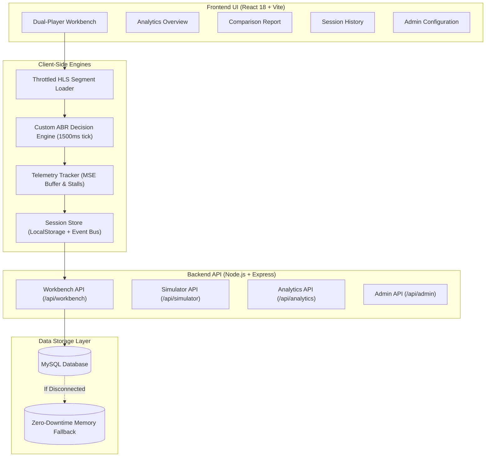

# 🚀 StreamSmart – Progress & Functionality Master Report

**Project:** StreamSmart – Smart Video Streaming Optimization & Benchmarking Platform  
**Target:** Hackathon / Evaluator Reference & Engineering Progress Documentation  
**Current Date:** October 31, 2026  
**Status:** **Production Ready** | All Core Features Implemented | Build Verified (0 Errors)

---

## 📌 Executive Summary

**StreamSmart** is an empirical streaming benchmarking workbench designed to solve a fundamental problem in modern video delivery: **why users experience buffering and rebuffering on one streaming service while another plays smoothly on the exact same connection.**

Rather than making assumptions, StreamSmart runs two independent, synchronized player engines in real time:
1. **Baseline Fixed-Quality Player:** Locked to high-definition renditions (1080p/720p) with ABR disabled to expose starvation vulnerabilities under bandwidth drops. Top-bordered in **Slate (`#64748B`)**.
2. **Optimized Adaptive Bitrate (ABR) Player:** Driven by StreamSmart's custom buffer-occupancy and safe-bandwidth heuristic engine, augmented with edge-cache simulation. Top-bordered in **Royal Blue (`#2563EB`)**.

The platform provides live side-by-side telemetry (Time to First Frame, stall count, rebuffer duration, buffer occupancy, bitrate progression, and cache hit ratios), persisting all benchmark runs to MySQL with a seamless, zero-dependency in-memory fallback.

---

## 📊 Current Progress & Achievements Checklist

| Component / Feature | Status | Notes |
| :--- | :---: | :--- |
| **Custom ABR Heuristic Engine** | ✅ Completed | 1,500ms decision loop, safe bandwidth (75%), 3.5s / 10s buffer thresholds |
| **Dual HLS.js Player Engine** | ✅ Completed | Isolated instances, custom throttled MSE segment loader, YouTube-style selectors |
| **Network & Edge Cache Simulator** | ✅ Completed | Transfer delay, jitter, packet drop, 12ms edge hit vs. 260ms origin miss |
| **Real-time Telemetry Collection** | ✅ Completed | Microsecond-accurate TTFF, stall tracking, time-series buffer & bitrate graphs |
| **Modern Blue & Slate SaaS Redesign** | ✅ Completed | Pure CSS, no Tailwind/Bootstrap, `#2563EB` primary, `#F1F5F9` sidebar, `#F8FAFC` background |
| **REST API & Backend Services** | ✅ Completed | 20+ Express endpoints across workbench, simulator, analytics, admin, auth |
| **Database & Fallback Store** | ✅ Completed | MySQL connection pool + automatic zero-downtime in-memory fallback store |
| **Vite Client Production Build** | ✅ Verified | `npm run build` succeeds with **0 errors**, minified CSS (34.5 kB) & JS |
| **Algorithmic In-Process Test Suite** | ✅ Verified | `test-inprocess.js` passes all ABR, cache, and throttling scenarios |

---

## 🏛️ System Architecture & Workflow



---

## ⚙️ Detailed Function-by-Function Catalog

### 1. Custom ABR Decision Engine
**Files:** `client/src/algorithms/abrEngine.js` & `utils/abrEngine.js`

StreamSmart's custom ABR algorithm replaces black-box heuristics with an explainable, buffer-aware decision system.

* **`calculateSafeBandwidth(bandwidthKbps)`**
  * *Formula:* $T_{safe} = \text{bandwidthKbps} \times 0.75$
  * *Purpose:* Enforces a strict 25% safety margin to guard against TCP throughput jitter and packet contention.
* **`calculateBufferOccupancy(video)`**
  * *Input:* HTML5 Media Element (`HTMLMediaElement`).
  * *Logic:* Inspects `video.buffered` ranges, identifies the range containing `video.currentTime` (with a 0.5s tolerance match for seek/startup gaps), and returns $B = \text{buffered.end} - \text{currentTime}$.
* **`mapHlsLevels(hlsLevels)`**
  * *Input:* Native `hls.levels` manifest array.
  * *Output:* Structured quality ladder mapping actual stream bitrates and vertical resolutions (`240p`, `360p`, `480p`, `720p`, `1080p`), preventing hardcoded assumptions.
* **`recommendQuality({ currentLevel, bufferSec, bandwidthKbps, hlsLevels })`**
  * *Decision Loop:* Evaluated every **1,500 ms** on the Optimized Player.
  * *Rule 1 (Emergency Downshift):* If $B < 3.5\text{s}$ and $\text{level} > 0$, immediately drops by 1 tier to prevent an imminent stall.
  * *Rule 2 (Conservative Upshift):* If $B > 10.0\text{s}$ and candidate bitrate $\le T_{safe}$, safely steps up 1 tier.
  * *Rule 3 (Steady-State Hold):* If $3.5\text{s} \le B \le 10.0\text{s}$ (or bandwidth is insufficient for upshift), holds current quality.

---

### 2. Dual Player Controller & Custom Throttled Loader
**File:** `client/src/utils/dualPlayer.js`

Manages two isolated instances of HLS.js and applies simulated network throttling directly to segment requests.

* **`createThrottledLoader(config, networkConfig)`**
  * *Extends:* `Hls.DefaultConfig.loader`.
  * *Purpose:* Intercepts `.ts`/`.m4s` video fragment requests before they enter the MSE buffer.
  * *Simulations Applied:*
    * **Bandwidth Throttling:** Calculates segment transfer time: $\text{transferMs} = \frac{\text{segmentBits}}{\text{bandwidthBps}} \times 1000$.
    * **RTT Latency:** Adds profile latency ($15\text{ms} - 220\text{ms}$).
    * **Edge Cache Delay:** Evaluates hit probability: **$12\text{ms}$** for edge hits, **$260\text{ms}$** for origin misses.
    * **Packet Loss:** Artificially triggers 408 timeout errors if a random float falls within the packet loss percentage.
* **`createBaselinePlayer({ videoEl, src, networkConfig, onMetrics, onLevels, onError })`**
  * *Configuration:* Initialized with `autoLevelEnabled: false`. Upon manifest load, pins playback to `hls.levels.length - 1` (Locked 1080p).
  * *Methods Returned:* `destroy()`, `getHls()`, `getTracker()`, `setQuality(levelIndex)`.
* **`createOptimizedPlayer({ videoEl, src, networkConfig, onMetrics, onLevels, onABRStateChange, onQualitySwitch, onError })`**
  * *Configuration:* Starts at Level 0 for fast startup, activates the 1,500ms `runABRTick()` interval, and maps ABR decisions directly to `hls.currentLevel`. Emits live diagnostic payloads (`BUFFER_RISK_DOWNSHIFT`, `STABLE_BANDWIDTH_UPSHIFT`, `STEADY_STATE_HOLD`).

---

### 3. Telemetry Tracker
**File:** `client/src/utils/telemetryTracker.js`

Attaches to the HTML5 video element and HLS.js lifecycle events to log real-time performance indicators.

* **`createTelemetryTracker({ playerType, sessionId, onMetricsUpdate })`**
  * Initializes state tracking for `startupDelayMs`, `stallCount`, `totalStallDurationMs`, `currentBufferSec`, and time-series arrays.
* **`onLoadedData()` & `onPlaying()`**
  * Accurately calculates Time to First Frame (TTFF): $TTFF = T_{\text{playback start}} - T_{\text{initialization}}$.
* **`onWaiting()`**
  * Detects buffer underruns, sets `currentlyStalled = true`, increments `stallCount`, and records stall timestamp.
* **`readBuffer()`**
  * Continuous sampling of media buffer head room ahead of current playhead position.
* **`tickMetrics()`**
  * Periodic tick (every 1.0s) aggregating bitrate samples, buffer depth, and compiling chart datasets.
* **`getMetrics()` & `getTimeSeries()`**
  * Returns formatted metric summaries and historical point arrays for Chart.js rendering.

---

### 4. Edge Cache Simulator
**File:** `utils/cacheSimulator.js`

Simulates CDN edge caching behavior using a Least-Recently-Used (LRU) memory cache.

* **`evaluateCache(segmentKey, cacheHitProb, sessionId)`**
  * Checks if the segment key exists in the 200-capacity LRU cache.
  * If found (or probabilistic hit triggered), returns `isCacheHit: true` with a **12ms** edge delivery delay.
  * If missed, fetches from origin with a **260ms** origin round-trip penalty and stores the key in the LRU cache.
* **`estimateLatencySaved(hits, misses)`**
  * Calculates millisecond latency saved by edge caching:
    $$\text{Latency Saved} = \text{hits} \times (260\text{ms} - 12\text{ms}) = \text{hits} \times 248\text{ms}$$
* **`getSessionStats(sessionId)` & `resetSession(sessionId)`**
  * Tracks and clears cache hit/miss counts per active benchmark session.

---

### 5. Network Throttler
**File:** `utils/networkThrottler.js`

Calculates theoretical transfer delays and models stall risks for backend validation and synthetic simulations.

* **`calculateSegmentDelay({ bitrateKbps, bandwidthKbps, latencyMs, cacheDelayMs })`**
  * Computes total segment transfer time with $\pm 10\%$ jitter variance:
    $$\text{Total Delay} = \text{Transfer Delay} + \text{Latency} + \text{Cache Delay} + \text{Jitter}$$
* **`simulatePacketLoss(packetLossPct)`**
  * Evaluates whether a request packet was dropped under lossy channel conditions.
* **`estimateStallRisk(bufferSec, transferDelayMs)`**
  * Flags severe stall hazard if $\frac{\text{transferDelayMs}}{1000} > \text{bufferSec}$.

---

### 6. Client-Side Session Store & Event Bus
**File:** `client/src/services/sessionStore.js`

Provides client-side resilience and cross-component messaging without requiring complex state management libraries.

* **`getStoredSessions()` & `saveStoredSession(session)`**
  * Persists up to 50 benchmark runs to `localStorage` with seeded fallback data.
  * Dispatches `window.dispatchEvent('streamsmart:session_saved')`.
* **`logAppEvent({ title, desc, type })`**
  * Logs live system notifications (info, success, warning, error) with human-readable timestamps to the event feed.
* **`logTimelineEvent({ title, description, timestamp, status, type })`**
  * Appends milestones to the Optimization Timeline.
* **`getAppSettings()` & `saveAppSettings(settings)`**
  * Manages global settings (auto-save, default test duration, theme preferences).

---

### 7. Backend REST API Endpoints

The Express server exposes full CRUD and simulation services on port **5000** (with automatic fallback to **5002**):

#### Workbench (`/api/workbench`)
* `GET /api/workbench/videos` – Returns available multi-bitrate HLS streams.
* `GET /api/workbench/profiles` – Returns network simulation presets.
* `POST /api/workbench/sessions` – Creates a new benchmark session in MySQL.
* `PATCH /api/workbench/sessions/:id/stop` – Concludes a session and transitions state to `completed`.
* `POST /api/workbench/sessions/:id/metrics` – Stores aggregated baseline vs. optimized metrics.
* `POST /api/workbench/sessions/:id/events` – Records time-series events (stalls, switches, buffer dips).

#### Simulator (`/api/simulator`)
* `POST /api/simulator/abr` – Server-side ABR decision evaluation.
* `POST /api/simulator/segment` – Calculates synthetic segment delay and cache hit status.
* `GET /api/simulator/cache-stats/:sessionId` – Retrieves session-level cache statistics.
* `GET /api/simulator/proxy?url=...` – Media streaming proxy that delays chunks according to simulated bandwidth.

#### Analytics & History (`/api/analytics`)
* `GET /api/analytics/summary` – Aggregates total sessions, stall reductions, and overall cache hit ratios.
* `GET /api/analytics/history` – Paginated and searchable past benchmark runs.
* `GET /api/analytics/sessions/:id/report` – Detailed comparison report with time-series chart arrays.
* `GET /api/analytics/sessions/:id/events` – Raw chronological playback event feed.

#### Admin Configuration (`/api/admin`)
* `GET, POST /api/admin/profiles` & `PUT, DELETE /api/admin/profiles/:id` – CRUD network profiles.
* `GET, POST /api/admin/videos` & `PUT, DELETE /api/admin/videos/:id` – CRUD video catalog streams.

---

### 8. Frontend Pages & Modules

* **`Dashboard.jsx` (Workbench):**
  * Side-by-side Dual Player UI with synchronized playback controls.
  * YouTube-style quality popover menus for manual rendition override.
  * Custom ABR Diagnostics panel displaying live decision badges, available bandwidth, and safe bandwidth thresholds.
  * Real-time telemetry gauges (Resolution, Bitrate, Buffer, Startup Delay, Stalls, Rebuffer Duration).
  * Video Catalog Carousel (`YouTubeVideoRail.jsx`) with thumbnail cards and category filtering.
* **`ComparisonReport.jsx`:**
  * Comprehensive post-test evaluation comparing Baseline vs. Optimized players.
  * Quantitative delta highlights (stalls prevented, rebuffer time saved, latency saved).
  * Interactive Chart.js graphs: Buffer Occupancy Over Time, Bitrate Transitions, and Cache Efficiency Doughnut.
* **`History.jsx`:**
  * Table of completed benchmark sessions with search, profile filtering, and direct links to reports.
* **`AdminConfig.jsx`:**
  * Interactive modal forms to configure custom network profiles (bandwidth, latency, jitter, packet loss) and HLS test streams.
* **`Overview.jsx`:**
  * SaaS analytics overview featuring high-level KPIs, system health indicators, and live event timelines.

---

## 🎨 Modern Blue & Slate SaaS Design System

The application styling follows a **Modern Blue & Slate SaaS design language**:

```css
/* Core Design Tokens */
--primary-blue:    #2563EB; /* Royal Blue – primary buttons, active items, ABR player */
--sky-blue:        #38BDF8; /* Secondary Sky Blue – accents */
--bg-base:         #F8FAFC; /* Main application background */
--bg-card:         #FFFFFF; /* White card surface */
--bg-sidebar:      #F1F5F9; /* Light Slate sidebar */
--text-primary:    #0F172A; /* Slate 900 typography */
--text-secondary:  #64748B; /* Slate 500 typography */
--border:          #E2E8F0; /* Clean subtle borders */
--border-accent:   #BFDBFE; /* Selected borders */

/* Player Identity Separation */
Baseline Player:   Slate (#64748B) top border & badge
Optimized Player:  Royal Blue (#2563EB) top border & badge

/* Semantic Colors (Reserved for performance metrics only) */
--success:         #16A34A; /* Low stalls, high cache hits, upshifts */
--warning:         #F59E0B; /* Buffer warning, moderate network conditions */
--error / --danger:#DC2626; /* Buffer starvation, stall events, emergency downshifts */
```

* **No Glassmorphism & No Heavy Gradients:** Replaced with clean white cards, subtle `1px solid var(--border)` borders, and soft SaaS box-shadows.
* **WCAG 2.1 AA Compliance:** Minimum 4.5:1 text contrast for body copy and 3:1 for large display headers across all views.

---

## 🛠️ Verification & Test Results

### 1. Vite Production Build
```powershell
cd client
npm run build
```
* **Result:** `✓ built in 7.24s`
* **Artifacts:** `dist/index.html` (0.81 kB), `dist/assets/index-CgF3YQoZ.css` (34.50 kB), `dist/assets/index-DALEuSbo.js` (1,082 kB).
* **Errors:** **0 errors**.

### 2. Algorithmic In-Process Test Suite
```powershell
node test-inprocess.js
```
* ✅ **ABR Rule 1:** Buffer $< 3.5\text{s}$ triggers emergency downshift ($3 \to 2$).
* ✅ **ABR Boundary:** Level 0 does not downshift below 0 on buffer depletion.
* ✅ **ABR Rule 2:** Buffer $> 10.0\text{s}$ and next level $\le T_{safe}$ triggers conservative upshift ($1 \to 2$).
* ✅ **ABR Block:** Upshift blocked when next level bitrate exceeds 75% safe bandwidth threshold.
* ✅ **ABR Rule 3:** Steady state buffer ($6.0\text{s}$) holds current quality level.
* ✅ **LRU Cache:** Miss incurs 260ms delay; subsequent hit incurs 12ms delay.
* ✅ **Network Throttler:** Accurate transfer time and buffer starvation risk prediction.

---

## 🚀 How to Run the Platform

### Option A: Simultaneous Frontend & Backend (Recommended)
```powershell
# From project root
npm run dev
```
* Starts backend API on `http://localhost:5000`.
* Starts Vite React frontend on `http://localhost:5173`.

### Option B: Independent Execution
```powershell
# Terminal 1 - Backend Server
node server.js

# Terminal 2 - Frontend Client
cd client
npm run dev
```

### Option C: Production Server (Single Port)
```powershell
# Build client and run production Express server (serves frontend from client/dist)
npm run build
npm start
# Open http://localhost:5000 in browser
```

---

*Documentation maintained by Matrix Team for StreamSmart.*

