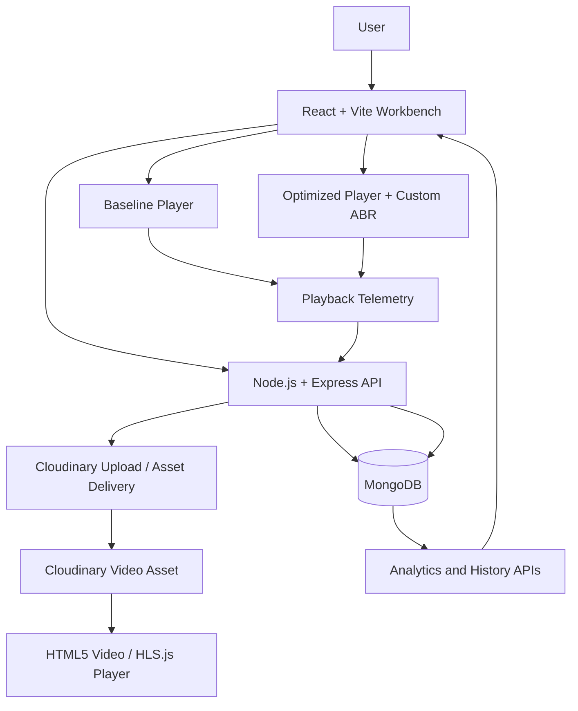
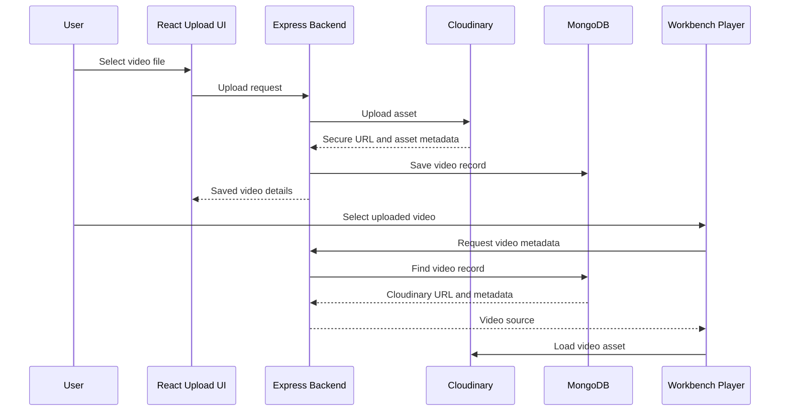

# StreamSmart — Smart Video Streaming Optimization & Benchmarking Platform

> A web-based workbench for comparing fixed-quality video playback with adaptive bitrate (ABR) playback under configurable network conditions.

**Event:** INNOVISTA — 36-Hour Hackathon, Problem Statement 02  
**Domain:** Networking · Web Development · Data Analytics

---

## 1. Overview

StreamSmart is designed to investigate why two video players can behave differently under the same network conditions. It provides a side-by-side benchmarking environment with:

- **Baseline Player:** plays the selected video at a fixed quality level.
- **Optimized Player:** uses StreamSmart's adaptive bitrate logic to select a suitable quality level based on available bandwidth and buffer health.
- **Network Workbench:** allows test conditions such as bandwidth and latency to be configured.
- **Analytics:** presents playback and test-session information so the two playback strategies can be compared.

The application uses **MongoDB for persistent application data** and **Cloudinary to host uploaded video assets**. Video delivery and playback are handled by the browser video element and the streaming/player integration configured for each asset.

> **Measurement note:** configured network values, simulated values, and browser-observed playback values are different data categories. The interface and reports should label them separately. A configured bandwidth value must not be presented as measured throughput unless it was actually measured.

## 2. Key Features

### Dual-player benchmarking

| Component | Responsibility |
|---|---|
| Baseline Player | Keeps playback at the selected fixed quality; it should not follow the Optimized Player's ABR decisions. |
| Optimized Player | Runs the custom ABR decision logic and applies the selected quality to its own player instance. |
| Shared test configuration | Supplies both players with the same video and intended network-test settings for a fair comparison. |
| Telemetry | Captures playback events and metrics for comparison and history. |

The players must maintain independent playback instances and independent quality state. A quality change in the Optimized Player must update the Optimized Player's own quality indicator and must not change the Baseline Player.

### Adaptive bitrate (ABR)

The custom ABR controller is intended to make conservative quality decisions using buffer occupancy and a bandwidth estimate. The documented decision policy is:

- **Emergency downshift:** when buffer occupancy falls below 3.5 seconds, step down one available quality level.
- **Conservative upshift:** when buffer occupancy exceeds 10 seconds and the next rendition fits within 75% of the available bandwidth estimate, step up one level.
- **Steady state:** otherwise, keep the current level.

The controller must use the actual quality levels available for the selected video. It must not assume that every uploaded video has the same rendition ladder. When the custom controller is active, the player's built-in automatic ABR must not compete with it.

**Important:** these thresholds describe the intended algorithm. Verify the actual level change in playback and in the Optimized Player UI before treating ABR as fully operational. The displayed quality should be read from the Optimized Player's active player instance, not from a static label or the Baseline Player.

### Network testing and cache simulation

The workbench is intended to support controlled network scenarios, including bandwidth and latency, with cache behavior where that simulation is connected to media-segment delivery.

A simulator value affects actual playback only when the media requests pass through the relevant throttling/proxy/custom-loader path. If the video is fetched directly from Cloudinary or another origin without that integration, the configured simulator values may be recorded as test settings but do not, by themselves, throttle the real media transfer.

### Playback analytics

The analytics layer can present metrics such as:

- Startup time / time to first frame
- Buffer occupancy
- Buffering or stall count and duration
- Current playback quality / bitrate, where exposed by the player
- Quality-switch events
- Segment loading information, where available
- Cache hits, misses, and simulated delay, when the cache simulation is active

Charts should be populated from actual telemetry records. Do not fabricate chart points or show placeholder values as real measurements. Historical reports should be based on saved sessions.

### Cloud video hosting

Uploaded video assets are hosted through **Cloudinary** rather than relying on a local video file path. The application should save the returned Cloudinary asset URL and relevant metadata in MongoDB, then use that saved URL when loading the video in the workbench.

The exact playback integration depends on the asset URL and format:

- A direct MP4 delivery URL is played as a video file by the HTML5 `<video>` element.
- An HLS manifest URL (`.m3u8`) can be handled by HLS.js in browsers that support Media Source Extensions, with native HLS as a possible fallback on supported browsers.
- A direct MP4 URL is not automatically an HLS multi-bitrate stream. ABR rendition switching requires an actual set of compatible renditions or an adaptive streaming manifest and a player integration that exposes those levels.

The upload flow, saved asset record, and workbench video selection must all refer to the same Cloudinary asset. A successful upload alone does not prove that the workbench can fetch, load, or play the asset.

## 3. Technology Stack

| Layer | Technology | Role |
|---|---|---|
| Frontend | React, Vite, HTML5, CSS | Workbench, player UI, controls, dashboards, and reports |
| Backend | Node.js, Express.js | REST APIs, upload handling, validation, sessions, and telemetry |
| Database | MongoDB | Persistent users, video metadata, network profiles, test sessions, metrics, and events |
| Video hosting | Cloudinary | Cloud storage and delivery of uploaded video assets |
| Streaming/player | HTML5 Video API, HLS.js where HLS is used | Video playback, HLS manifest/segment handling, and player events |
| Charts | Chart.js | Playback and benchmarking visualizations |
| API communication | Fetch API / REST | Frontend-to-backend communication |

**Styling:** custom CSS. Bootstrap is not required by the architecture described here.

## 4. System Architecture



### Main request flow

1. The user opens the StreamSmart workbench.
2. The user uploads a video or selects an existing uploaded asset.
3. The backend handles the upload and stores the Cloudinary asset reference and video metadata in MongoDB.
4. The user selects a video and configures the test scenario.
5. The backend validates the test configuration and creates a test session.
6. The frontend initializes separate Baseline and Optimized player instances.
7. The Optimized Player runs the custom ABR controller when compatible adaptive renditions are available.
8. Playback events and test metrics are sent to the backend.
9. The backend persists supported session and telemetry data in MongoDB.
10. The frontend retrieves analytics and displays the comparison.

## 5. Video Playback Architecture

### HTML5 Video and HLS.js

The HTML5 `<video>` element performs media playback and decoding. HLS.js is used when the selected source is an HLS manifest and the browser supports the Media Source Extensions path. HLS.js loads the manifest and media playlists, requests segments, appends media data to the browser buffer, and exposes events and quality-level information.

Each player should own its own playback instance:

- **Baseline:** uses a fixed selected rendition/quality. It must not be changed by the Optimized Player's ABR controller.
- **Optimized:** uses the custom ABR controller to select among the renditions available in the selected adaptive stream.

For HLS.js, useful integration points include `Hls.isSupported()`, `loadSource()`, `attachMedia()`, `hls.levels`, `hls.currentLevel`, `hls.bandwidthEstimate`, `MANIFEST_PARSED`, `FRAG_LOADED`, `LEVEL_SWITCHED`, and `ERROR`. Clean up each instance when its component unmounts or its source changes.

For a direct MP4 source, the browser uses the native video playback path. Do not assume HLS.js quality levels exist for a normal MP4 asset.

### Cloudinary upload-to-playback flow



Keep Cloudinary API secrets on the server. Do not expose the Cloudinary API secret in frontend code or commit credentials to the repository. If the project uses unsigned uploads, configure and restrict the upload preset appropriately; otherwise use a server-signed upload flow.

## 6. MongoDB Data Model

MongoDB stores application records as documents in collections. The following collection design describes the data the application needs; collection names and field names should be aligned with the actual models in the repository.

| Collection | Example document purpose / fields |
|---|---|
| `users` | User identity, authentication fields, role, creation timestamp |
| `videos` | Title, Cloudinary `public_id`, secure delivery URL, resource type, format, duration, dimensions, upload timestamp, and streaming format/manifest URL when available |
| `networkprofiles` | Profile name, configured bandwidth, latency, packet loss, and cache-hit probability |
| `testsessions` | User/video references, network settings, measurement mode, duration, status, start/end timestamps |
| `playermetrics` | Session reference, player type (`BASELINE` or `OPTIMIZED`), startup time, stall metrics, average bitrate, quality switches, cache counters |
| `playbackevents` | Session reference, player type, event type, elapsed time, quality/resolution, buffer level, segment delay, and cache outcome |

### Example video document

```json
{
  "title": "Demo Video",
  "cloudinary": {
    "publicId": "streamsmart/demo-video",
    "secureUrl": "https://res.cloudinary.com/<cloud-name>/video/upload/<asset-path>",
    "resourceType": "video",
    "format": "mp4"
  },
  "duration": 60,
  "createdAt": "2026-11-01T00:00:00.000Z"
}
```

This is an illustrative shape, not a guarantee of the exact schema currently implemented. Use the actual model fields from the project when integrating or changing the database.

### MongoDB connection configuration

The backend should read its MongoDB connection string from an environment variable, for example `MONGODB_URI`. The connection module should establish the database connection before database-dependent routes or background jobs are used. Do not keep a MySQL connection pool, SQL schema, or `mysql2` dependency in the active MongoDB architecture.

## 7. ABR Decision Logic

Let:

- \(B\) = current buffered playback duration in seconds
- \(BW\) = available bandwidth estimate in kbps
- \(T_{safe}\) = safe bandwidth threshold
- \(R_{next}\) = bitrate of the next higher rendition

The safe bandwidth threshold is:

\[
T_{safe} = 0.75 \times BW
\]

Decision policy:

| Condition | Decision |
|---|---|
| \(B < 3.5\) seconds and a lower level exists | Downshift one level |
| \(B > 10\) seconds and \(R_{next} \leq T_{safe}\) | Upshift one level |
| Otherwise | Keep the current level |

Implementation requirements:

1. Read buffer occupancy from the Optimized Player's video element.
2. Use a clearly identified bandwidth source: measured estimate or configured simulation input.
3. Select only valid indexes from the selected stream's actual rendition list.
4. Apply the selected level to the Optimized Player's own HLS.js instance.
5. Update the Optimized Player's quality label from the active level after the player confirms the change.
6. Log a quality-switch event only when a real level change occurs.
7. Prevent the built-in HLS.js ABR controller from competing with the custom controller.

A static UI label changing without a corresponding player-level change is not proof of ABR. Likewise, a video resolution changing without the ABR panel, quality indicator, and telemetry updating consistently indicates that the UI and player state are not synchronized.

## 8. Network Simulation and Cache Model

A network simulator may model bandwidth, latency, jitter, packet loss, and cache outcomes. These settings must be connected to the media request path before they can be said to affect playback.

For a segment of size \(S_{bytes}\), a simplified transfer-time estimate is:

\[
T_{transfer(ms)} = \frac{S_{bytes} \times 8}{BW_{bps}} \times 1000
\]

A simplified total delay model can include transfer time, configured latency, jitter, and cache delay:

\[
T_{total} = T_{transfer} + T_{latency} + T_{jitter} + T_{cache}
\]

If the project uses example cache delays, clearly identify them as simulation assumptions rather than measurements from a production CDN. Cloudinary's delivery infrastructure should not be described as a custom edge-cache implementation unless the application actually measures and integrates that cache.

**Critical integration point:** HLS.js normally requests media segments from the URLs in the manifest. An Express simulation endpoint does not automatically intercept those requests. To apply simulated conditions to actual segment delivery, route requests through a custom HLS.js loader or a media proxy. If the workbench currently loads a direct Cloudinary MP4 URL, HLS segment-level simulation and rendition switching will not be available through that MP4 source alone.

## 9. Telemetry and Analytics

Telemetry should distinguish between:

- **Playback-observed metrics:** values derived from HTML5 video and player events, such as `playing`, `waiting`, `timeupdate`, `loadeddata`, buffered ranges, and HLS.js events where applicable.
- **Configured test parameters:** values selected by the user, such as target bandwidth and latency.
- **Simulated values:** values generated by the network/cache simulator.
- **Persisted results:** session summaries and event records successfully saved in MongoDB.

Suggested dashboard visualizations:

1. **Buffer and quality timeline:** buffer occupancy and active quality over elapsed playback time for both players.
2. **Startup and rebuffering comparison:** startup delay, stall count, and total stall duration for Baseline versus Optimized.
3. **Cache efficiency:** cache hits and misses, with simulated delay savings labelled as estimates when they are not measured from a real cache service.

Charts should use timestamps and session IDs from the telemetry pipeline. Empty or failed API responses should be represented as unavailable/no data, not as fabricated zero-valued measurements.

## 10. API Responsibilities

The exact endpoint names depend on the implementation. The backend is responsible for these API capabilities:

| API area | Responsibility |
|---|---|
| Authentication | Register/login, session or token handling, role checks |
| Videos | Upload video, list videos, fetch video metadata, delete/manage assets where supported |
| Workbench | Validate configuration and create/start/complete test sessions |
| Simulation | Provide network settings and simulation results |
| Telemetry | Receive playback events and session metrics |
| Analytics | Retrieve session history, comparisons, and chart data |
| Administration | Manage network presets and application configuration |

Validate uploaded files, request bodies, Cloudinary responses, and session references on the server. Return clear errors when an upload succeeds but the asset record cannot be saved, or when a video record exists but its playback URL cannot be loaded.

## 11. Environment Configuration

Create a backend `.env` file and keep it out of version control. Variable names must match the backend configuration code. A typical configuration may look like:

```env
PORT=5001
MONGODB_URI=mongodb://127.0.0.1:27017/streamsmart

CLOUDINARY_CLOUD_NAME=your_cloud_name
CLOUDINARY_API_KEY=your_api_key
CLOUDINARY_API_SECRET=your_api_secret

# Add other application-specific settings used by the project:
# JWT_SECRET=...
# CLIENT_URL=http://localhost:5173
```

For MongoDB Atlas, use the Atlas connection string as `MONGODB_URI` and ensure the database user's permissions and network access rules allow the backend to connect.

Do not paste real secrets into README files, source control, screenshots, or frontend environment variables. Frontend variables are public once bundled.

## 12. Local Setup

Prerequisites:

- Node.js and npm
- MongoDB local instance or MongoDB Atlas database
- Cloudinary account and video-upload credentials
- Git

Clone the repository:

```bash
git clone <your-repository-url>
cd <repository-folder>
```

Install backend dependencies from the backend project directory:

```bash
npm install
```

If the frontend is in a separate `client` directory:

```bash
cd client
npm install
cd ..
```

Configure the backend `.env` file with `MONGODB_URI` and the required Cloudinary credentials. Start the backend using the script defined in its `package.json`, for example:

```bash
npm start
```

Start the frontend using the script defined in `client/package.json`, for example:

```bash
cd client
npm run dev
```

The exact commands and ports should be checked against the repository's current `package.json` files. Do not commit `.env` or `node_modules`.

## 13. Verification Checklist

Use this checklist before a demo or release. Mark a feature complete only after it has been tested in the running application.

### Database and Cloudinary

- [ ] Backend connects to MongoDB successfully on startup.
- [ ] Video upload reaches Cloudinary and returns a valid secure URL.
- [ ] The video metadata and Cloudinary `public_id` are saved in MongoDB.
- [ ] The workbench lists the uploaded video from the backend.
- [ ] Selecting the video loads the same Cloudinary asset that was uploaded.
- [ ] Invalid URLs, failed uploads, and database errors produce visible, useful errors.
- [ ] Cloudinary secrets remain server-side.

### Workbench and playback

- [ ] Test session creation succeeds with a valid configuration.
- [ ] Both players load the selected source.
- [ ] Baseline quality remains fixed during the test.
- [ ] Optimized Player's quality indicator reflects its actual active quality.
- [ ] ABR changes the Optimized Player's rendition when a compatible adaptive stream and test conditions allow it.
- [ ] A quality change in one player does not affect the other player.
- [ ] Playback errors, loading states, and unsupported source formats are handled clearly.

### Simulation and analytics

- [ ] Configured bandwidth and latency are passed to the intended simulation logic.
- [ ] The simulation is connected to media delivery before claiming it changes actual playback.
- [ ] Browser-observed and simulated values are labelled separately.
- [ ] Buffering and quality-switch events are captured from real player events.
- [ ] Telemetry is saved to MongoDB and can be retrieved for a completed session.
- [ ] Charts show the selected session's actual data and handle missing data correctly.
- [ ] Baseline and Optimized results use the same video and intended test configuration.

## 14. Current Development Notes

The following points are important integration checks for the current project:

- The database architecture has moved from MySQL to MongoDB. Remove obsolete MySQL-specific setup instructions, SQL schema references, `mysql2` connection examples, and SQL seeding commands from active documentation and code.
- Uploaded video assets are hosted on Cloudinary. The workbench must retrieve the stored Cloudinary URL from the backend/database rather than relying on a local machine path.
- Cloudinary upload success and workbench playback success are separate checks. Test the complete upload → MongoDB record → video list/selection → player load flow.
- The ABR panel must display the Optimized Player's live quality state. Do not let the fixed Baseline Player's quality or a static UI value drive that display.
- Validate that the bandwidth control is connected to the ABR decision input and, separately, to actual request throttling if the goal is to simulate media delivery. A slider changing its displayed number alone does not prove either integration.
- Verify that graphs are derived from the current session's telemetry and are refreshed/reset correctly between runs.
- If a test fails, inspect the browser console, backend logs, network requests, MongoDB records, Cloudinary URL response, and player events to identify which stage failed.

These are verification requirements, not claims that every item is already implemented or passing.

## 15. Project Goal

StreamSmart aims to make video-streaming behavior measurable and explainable. By comparing fixed-quality playback with an adaptive strategy under controlled conditions, it helps demonstrate the relationship between bandwidth, buffer health, video quality, startup delay, and rebuffering.

The project's central requirement is a trustworthy comparison: same source, equivalent test conditions, independent player state, accurate telemetry, and clear separation between measured and simulated results.
