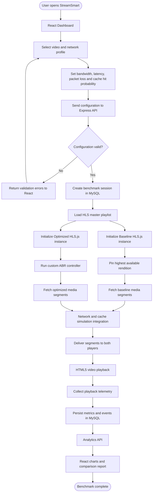
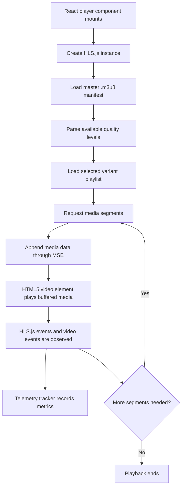
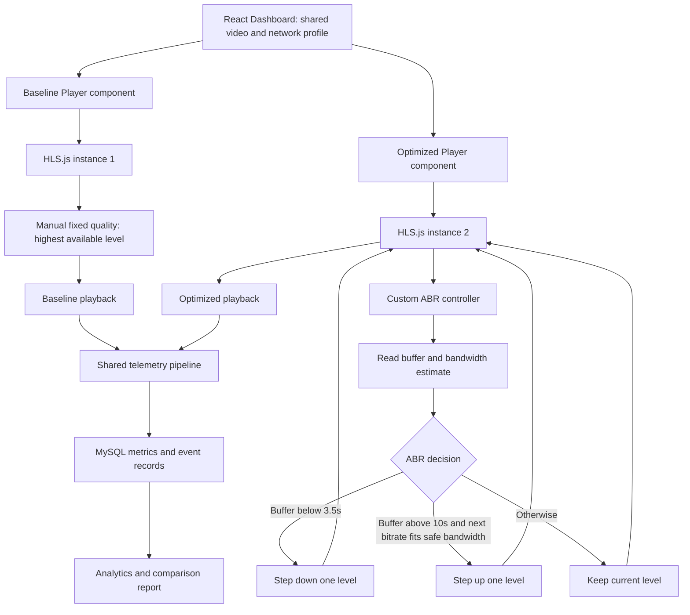
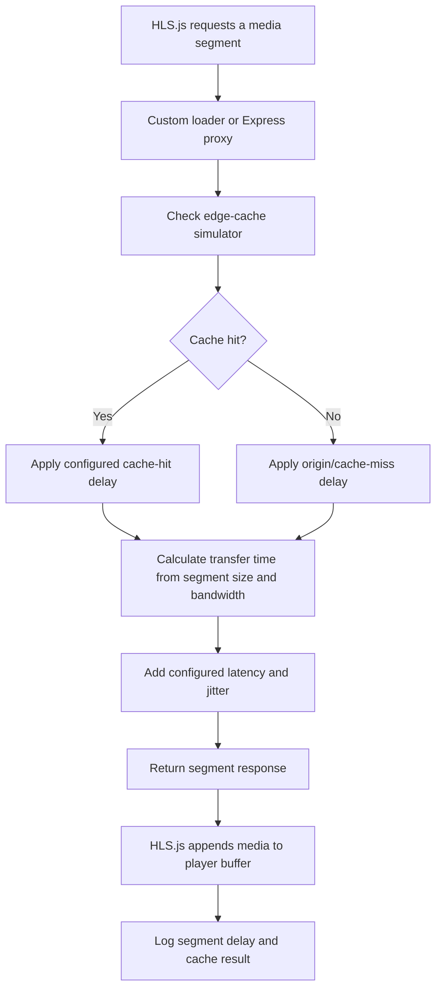

# 🛠️ making.md — StreamSmart: Architecture & Execution Blueprint

**Event:** INNOVISTA | 36-Hour Hackathon — Problem Statement 02  
**Project:** StreamSmart — Smart Video Streaming Optimization & Benchmarking Platform  
**Domain:** Networking | Web Development | Data Analytics  

---

## 📌 1. Project Overview & Core Value Proposition

Users frequently experience buffering on one streaming platform while another plays smoothly on the exact same internet connection. **StreamSmart** does not assume one configuration is universally superior; instead, it provides a **controlled, measurable dual-player benchmarking workbench**.

StreamSmart runs a **Fixed-Quality Baseline Player (Locked 1080p)** alongside an **Optimized Adaptive Player (ABR + Edge Caching)** under identical simulated or measured network conditions. It records startup latency, buffer starvation events, quality switches, and cache hit/miss ratios, persisting all telemetry in **MySQL** for live visualization, historical auditing, and side-by-side comparison.

---

## 💻 2. Technology Stack

We use a modular **React + Vite frontend** with an API-driven **Node.js + Express backend** and **MySQL** database. React manages the dashboard, player controls, analytics, history, and admin interface, while dedicated player modules interact with the HTML5 video elements and HLS.js. Express exposes REST APIs for configuration, simulation, telemetry, authentication, and reports.

| Layer | Technology | Purpose in StreamSmart |
| :--- | :--- | :--- |
| **Backend Runtime** | **Node.js** | Asynchronous event handling for non-blocking telemetry logging and simulated network routes. |
| **Web Framework** | **Express.js** | Modular routing, RBAC & pre-run validation middleware, and REST API endpoints. |
| **Frontend** | **React + Vite + HTML5 + CSS** | Component-based workbench dashboard, dual-player grid, admin panel, and network controls. |
| **API Communication** | **Fetch API / REST** | Connects React components to Express endpoints for session creation, configuration, simulation, telemetry, and analytics. |
| **Streaming Engine** | **HLS.js + HTML5 `<video>` API + Media Source Extensions (MSE)** | Loads HLS manifests and media playlists, requests video segments, appends media to browser buffers, and exposes level/fragment events and statistics. |
| **Data Visualization** | **Chart.js** | Real-time line, bar, and doughnut charts comparing throughput, buffer occupancy, and stall durations. |
| **Database** | **MySQL (`mysql2/promise`)** | Relational storage for users, sample videos, network presets, test sessions, comparative metrics, and events. |
| **Video Source** | **Public Multi-Bitrate HLS (`.m3u8`)** | Mux Test Stream (`https://test-streams.mux.dev/x36xhzz/x36xhzz.m3u8`) with multiple quality variants. |

**Frontend styling:** React components with custom CSS. Bootstrap is not used.

### 2.1 Role of HLS.js in StreamSmart

HLS.js is the browser-side HLS playback library. It works with an HTML5 `<video>` element and, in supported browsers, Media Source Extensions (MSE). HLS.js loads the master `.m3u8` playlist, reads the available variant playlists, requests media segments, appends media data to the browser's media buffer, and exposes playback/streaming events. The `<video>` element performs the actual playback and decoding.

StreamSmart creates **two independent HLS.js instances**, one for each player:

- **Baseline instance:** manually pinned to the highest available rendition (1080p where that rendition exists); built-in automatic quality selection is not used for the baseline test.
- **Optimized instance:** automatic quality selection is disabled when the custom ABR controller is active. The StreamSmart ABR engine selects a level using buffer occupancy and available/simulated bandwidth, then applies that level to the HLS.js instance.

Useful HLS.js data and events include `hls.levels`, `hls.currentLevel`, `hls.bandwidthEstimate`, `MANIFEST_PARSED`, `FRAG_LOADED`, `LEVEL_SWITCHED`, and `ERROR`. Native HLS playback can be used as a fallback on browsers that support it, but HLS.js-specific controls and events are not available in the same way on that fallback path.

**Basic React integration pattern:** install the dependency with `npm install hls.js`, create one HLS.js instance per player component, call `loadSource()` and `attachMedia()`, listen for relevant events, and call `destroy()` during cleanup. Use `Hls.isSupported()` for the MSE path and check `video.canPlayType("application/vnd.apple.mpegurl")` for native HLS fallback. Do not share one HLS.js instance between the baseline and optimized players.

**Important integration rule:** HLS.js normally requests playlists and media segments directly from the URLs in the manifest. Express simulation endpoints do not automatically intercept those requests. To make simulated bandwidth, latency, jitter, and cache behavior affect actual segment delivery, StreamSmart must route segment requests through a backend proxy or implement a custom HLS.js loader. Until that integration is implemented, simulation values should be clearly labelled as simulated and must not be presented as measured network effects on playback.

---

## 📁 3. Modular MVC Project Folder Structure

Modeled for clean separation of concerns across the React client, Express API, data models, validation middleware, and simulation utilities:

```text
streamsmart/
├── client/                       # React + Vite frontend
│   ├── public/
│   │   └── assets/               # Static assets
│   ├── src/
│   │   ├── components/
│   │   │   ├── layout/           # Navbar, sidebar, status badges
│   │   │   ├── players/          # BaselinePlayer and OptimizedPlayer
│   │   │   ├── charts/            # Live analytics charts
│   │   │   └── common/            # Reusable buttons, cards, inputs
│   │   ├── pages/
│   │   │   ├── Dashboard.jsx      # Dual-player workbench and network controls
│   │   │   ├── History.jsx        # Saved runs and session archive
│   │   │   ├── ComparisonReport.jsx # Baseline vs. optimized report
│   │   │   └── AdminConfig.jsx    # Network profiles and video configuration
│   │   ├── hooks/
│   │   │   └── useTelemetry.js    # Playback telemetry subscription
│   │   ├── services/
│   │   │   └── api.js             # Express REST API requests
│   │   ├── utils/
│   │   │   ├── dualPlayer.js      # HLS.js dual-player controller
│   │   │   ├── telemetryTracker.js # TTFF, stalls and buffer monitoring
│   │   │   └── chartController.js # Chart data adapters and updates
│   │   ├── App.jsx                # Routes and application layout
│   │   ├── main.jsx               # React entry point
│   │   └── styles/                # Custom responsive styles
│   ├── index.html
│   └── package.json               # React, Vite and frontend dependencies
├── config/
│   └── db.js                      # MySQL connection pool
├── models/
│   ├── User.js                    # Tester/admin queries
│   ├── VideoSample.js             # Sample video and quality renditions
│   ├── NetworkProfile.js          # Network scenario presets
│   ├── TestSession.js             # Benchmark run configuration
│   ├── PlayerMetric.js            # Baseline vs. optimized summaries
│   └── PlaybackEvent.js           # Time-series telemetry logs
├── middlewares/
│   ├── auth.js                    # Session/role checks
│   └── testValidator.js           # Pre-run configuration validation
├── utils/
│   ├── abrEngine.js               # Bandwidth safety margin and buffer logic
│   ├── cacheSimulator.js          # LRU edge-cache simulation
│   ├── networkThrottler.js        # Transfer delay, jitter and packet loss
│   └── eventLogger.js             # Asynchronous MySQL telemetry writer
├── routes/
│   ├── authRoutes.js              # Authentication endpoints
│   ├── workbenchRoutes.js         # Workbench and test-session endpoints
│   ├── simulatorRoutes.js         # Chunk simulation and ABR API
│   ├── analyticsRoutes.js         # Metrics, history and CSV export
│   └── adminRoutes.js             # Admin configuration and audit endpoints
├── schema.sql                     # MySQL database schema
├── seed.js                        # Demo data seeder
├── server.js                      # Express API entry point
└── package.json                   # Backend dependencies and scripts (frontend has its own client/package.json)
```

---

## 🔄 4. End-to-End System Workflow

### 4.1 Complete benchmark flow

The tester chooses a video and a network profile, validates the configuration, and starts a benchmark session. The React application then initializes two independent HLS.js players against the same multi-bitrate HLS source. Both players use the same selected test configuration and test duration.



### 4.2 HLS.js playback lifecycle

HLS.js is the streaming controller; it does not itself render the video. The HTML5 `<video>` element renders and plays the media. HLS.js obtains playlists and segments and uses Media Source Extensions (MSE) to append media data to the browser's playback buffer where supported.



Typical HLS.js integration points include `Hls.isSupported()`, `loadSource()`, `attachMedia()`, `hls.levels`, `hls.currentLevel`, `hls.bandwidthEstimate`, and events such as `MANIFEST_PARSED`, `FRAG_LOADED`, `LEVEL_SWITCHED`, and `ERROR`. Each React player must clean up its HLS.js instance (for example, by calling `hls.destroy()`) when the component unmounts or the source changes.

### 4.3 Dual-player comparison architecture



The two players must use the same source video, benchmark duration, and configured network scenario for a fair comparison. They are separate player instances and may have independent playback timing; the application should start them as close together as practical and record each player's actual start time.

### 4.4 Network and edge-cache simulation integration

The network simulator estimates segment transfer delay from segment size, configured bandwidth, latency, jitter, and cache outcome. The cache simulator determines whether a segment is served as a cache hit or cache miss. These values affect actual playback only after segment requests are routed through the custom HLS.js loader or an Express media proxy.



**Measurement modes:** In `SIMULATED` mode, report configured and simulated values separately from browser-observed playback metrics. In `REAL_BROWSER` mode, report browser-observed playback and network information where the browser exposes it. The Network Information API is not available in every browser and its `downlink` value is an estimate, not a guaranteed measurement of the exact media transfer rate.

### 4.5 Telemetry and reporting flow

The telemetry tracker combines HTML5 video events with HLS.js events. Examples include `loadeddata`/`playing` for startup, `waiting` and `playing` for stalls and resumes, `video.buffered` for buffer occupancy, and HLS.js fragment/level events for segment and quality information. The backend stores session summaries and event records; the React analytics pages retrieve them through the analytics API.

---

## 🧠 5. Core Algorithms & Mathematical Models

The hackathon requires explicit quality-selection and simulation logic in application code rather than relying on black-box defaults.

### 5.1 Custom Adaptive Bitrate (ABR) Heuristic (`client/src/utils/abrEngine.js` and `utils/abrEngine.js`)

Every `1500ms`, the custom controller inspects the **Optimized Player** buffer occupancy and available bandwidth estimate. The browser-side controller reads the current buffer from the HTML5 video element and can use HLS.js bandwidth estimates or the configured simulated bandwidth, depending on the benchmark mode. Keep the source of each bandwidth value explicit in telemetry.

When the custom controller is active, disable HLS.js automatic ABR for that player so the built-in controller and StreamSmart's controller do not compete. The controller selects a valid index from the actual `hls.levels` list; do not assume every HLS source contains exactly the five example quality tiers.

1. **Buffer Occupancy ($B$):**
   $$B = \text{video.buffered.end}(i) - \text{video.currentTime}$$

2. **Safe Bandwidth Threshold ($T_{\text{safe}}$):**
   Applies a $75\%$ safety margin to the estimated/simulated available bandwidth ($BW$) to absorb jitter:
   $$T_{\text{safe}} = BW_{\text{bps}} \times 0.75$$

**Switching Rules:**
* **Emergency Downshift (Buffer Risk Prevention):** If $B < 3.5\text{ seconds}$, immediately step down one quality level (`currentLevel - 1`) to prevent a playback stall.
* **Conservative Upshift:** If $B > 10.0\text{ seconds}$ AND the next higher rendition bitrate $\le T_{\text{safe}}$, step up one quality level (`currentLevel + 1`).
* **Steady State:** If $3.5\text{s} \le B \le 10.0\text{s}$, hold the current quality tier.

### 5.2 Network & Edge Caching Delay Formula (`utils/networkThrottler.js` & `utils/cacheSimulator.js`)

For each 4-second video segment of size $S_{\text{bytes}}$, when the segment request is routed through the simulation layer:

$$\text{Cache Penalty } (C_{\text{ms}}) = \begin{cases} 12\text{ ms} & \text{if Cache Hit } (\text{rand}() < P_{\text{hit}}) \\ 260\text{ ms} & \text{if Cache Miss (Origin Server Fetch)} \end{cases}$$

$$\text{Transfer Time } (D_{\text{ms}}) = \left( \frac{S_{\text{bytes}} \times 8}{BW_{\text{kbps}} \times 1000} \right) \times 1000 + \text{Latency}_{\text{ms}} + C_{\text{ms}}$$

* **Illustrative baseline case:** A 4-second `1080p` segment of approximately 2.5 MB contains about 20 megabits. At 2 Mbps, its ideal transfer time is about 10 seconds before additional latency and cache delay. If the player has less than 10 seconds of buffered content available, this can lead to a stall.
* **Illustrative optimized case:** A lower-bitrate `360p` segment of approximately 0.3 MB contains about 2.4 megabits. At 2 Mbps, its ideal transfer time is about 1.2 seconds before overhead. This can allow the player to replenish its buffer more quickly. Actual segment sizes and transfer times depend on the encoded source and measured conditions.

---

## 🗄️ 6. MySQL Database Architecture (6-Table Schema)

Using **MySQL** provides relational integrity across users, video catalogs, network presets, session summaries, side-by-side player outcomes, and time-series logs.

### 6.1 Entity-Relationship Diagram (ERD)

```
+-----------------------+       +-----------------------+       +-----------------------+
|         users         |       |     video_samples     |       |   network_profiles    |
+-----------------------+       +-----------------------+       +-----------------------+
| PK user_id (INT)      |       | PK video_id (INT)     |       | PK profile_id (INT)   |
|    username           |       |    title              |       |    profile_name       |
|    role ('tester' |   |       |    stream_url         |       |    bandwidth_kbps     |
|          'admin')     |       |    available_tiers    |       |    latency_ms         |
+-----------+-----------+       +-----------+-----------+       |    packet_loss_pct    |
            |                               |                   |    cache_hit_prob     |
            +---------------+---------------+-------------------+-----------+-----------+
                            | 1 : N                                         |
                            v                                               |
            +-----------------------------------------------+ <-------------+
            |                 test_sessions                 |
            +-----------------------------------------------+
            | PK session_id (INT)                           |
            | FK user_id (INT)                              |
            | FK video_id (INT)                             |
            | FK profile_id (INT)                           |
            |    sim_bandwidth_kbps                         |
            |    sim_latency_ms                             |
            |    sim_cache_hit_prob                         |
            |    created_at                                 |
            +-----------------------+-----------------------+
                                    |
        +---------------------------+---------------------------+
        | 1 : 2 (Baseline & Optimized)                          | 1 : N (Time-Series Logs)
        v                                                       v
+-------------------------------+               +-------------------------------+
|        player_metrics         |               |        playback_events        |
+-------------------------------+               +-------------------------------+
| PK metric_id (INT)            |               | PK event_id (INT)             |
| FK session_id (INT)           |               | FK session_id (INT)           |
|    player_type ENUM(...)      |               |    player_type ENUM(...)      |
|    startup_delay_ms           |               |    event_type ENUM(...)       |
|    stall_count                |               |    elapsed_sec                |
|    total_stall_duration_sec   |               |    resolution_label           |
|    avg_bitrate_kbps           |               |    buffer_level_sec           |
|    quality_switches           |               |    simulated_delay_ms         |
|    cache_hits / cache_misses  |               |    is_cache_hit               |
+-------------------------------+               +-------------------------------+
```

### 6.2 Complete SQL Setup Script (`schema.sql`)

```sql
CREATE DATABASE IF NOT EXISTS streamsmart_db;
USE streamsmart_db;

-- 1. Users Table (Viewer/Tester vs. Administrator/Evaluator)
CREATE TABLE users (
    user_id INT AUTO_INCREMENT PRIMARY KEY,
    username VARCHAR(50) NOT NULL UNIQUE,
    role ENUM('tester', 'admin') NOT NULL DEFAULT 'tester',
    created_at TIMESTAMP DEFAULT CURRENT_TIMESTAMP
);

-- 2. Sample Videos & Supported Quality Variants
CREATE TABLE video_samples (
    video_id INT AUTO_INCREMENT PRIMARY KEY,
    title VARCHAR(100) NOT NULL,
    stream_url VARCHAR(255) NOT NULL,
    available_tiers VARCHAR(100) NOT NULL DEFAULT '240p,360p,480p,720p,1080p',
    duration_sec INT NOT NULL DEFAULT 60,
    is_active BOOLEAN DEFAULT TRUE
);

-- 3. Pre-configured Network Scenarios (Evaluator Presets)
CREATE TABLE network_profiles (
    profile_id INT AUTO_INCREMENT PRIMARY KEY,
    profile_name VARCHAR(60) NOT NULL,
    bandwidth_kbps INT NOT NULL,
    latency_ms INT NOT NULL,
    packet_loss_pct DECIMAL(4,2) DEFAULT 0.00,
    cache_hit_prob DECIMAL(3,2) DEFAULT 0.50
);

-- 4. Master Benchmark Test Runs
CREATE TABLE test_sessions (
    session_id INT AUTO_INCREMENT PRIMARY KEY,
    user_id INT NULL,
    video_id INT NULL,
    profile_id INT NULL,
    sim_bandwidth_kbps INT NOT NULL,
    sim_latency_ms INT NOT NULL,
    sim_cache_hit_prob DECIMAL(3,2) NOT NULL,
    measurement_mode ENUM('SIMULATED', 'REAL_BROWSER') DEFAULT 'SIMULATED',
    test_duration_sec INT NOT NULL DEFAULT 30,
    created_at TIMESTAMP DEFAULT CURRENT_TIMESTAMP,
    FOREIGN KEY (user_id) REFERENCES users(user_id) ON DELETE SET NULL,
    FOREIGN KEY (video_id) REFERENCES video_samples(video_id) ON DELETE SET NULL,
    FOREIGN KEY (profile_id) REFERENCES network_profiles(profile_id) ON DELETE SET NULL
);

-- 5. Side-by-Side Aggregated Results (2 rows per session: BASELINE vs OPTIMIZED)
CREATE TABLE player_metrics (
    metric_id INT AUTO_INCREMENT PRIMARY KEY,
    session_id INT NOT NULL,
    player_type ENUM('BASELINE', 'OPTIMIZED') NOT NULL,
    startup_delay_ms INT NOT NULL,
    stall_count INT NOT NULL DEFAULT 0,
    total_stall_duration_sec DECIMAL(6,2) NOT NULL DEFAULT 0.00,
    avg_bitrate_kbps INT NOT NULL,
    quality_switches INT NOT NULL DEFAULT 0,
    cache_hits INT NOT NULL DEFAULT 0,
    cache_misses INT NOT NULL DEFAULT 0,
    FOREIGN KEY (session_id) REFERENCES test_sessions(session_id) ON DELETE CASCADE
);

-- 6. Granular Playback Event Log (For Chart Reconstruction & Audit)
CREATE TABLE playback_events (
    event_id INT AUTO_INCREMENT PRIMARY KEY,
    session_id INT NOT NULL,
    player_type ENUM('BASELINE', 'OPTIMIZED') NOT NULL,
    event_type ENUM('STARTUP', 'QUALITY_SWITCH', 'BUFFER_STALL', 'BUFFER_RESUME', 'SEGMENT_FETCH') NOT NULL,
    elapsed_sec DECIMAL(6,2) NOT NULL,
    resolution_label VARCHAR(20) NOT NULL,
    buffer_level_sec DECIMAL(5,2) NOT NULL,
    simulated_delay_ms INT DEFAULT 0,
    is_cache_hit BOOLEAN DEFAULT FALSE,
    FOREIGN KEY (session_id) REFERENCES test_sessions(session_id) ON DELETE CASCADE
);
```

---

## ⚙️ 7. Core Module Implementations

### 7.1 Database Connection (`config/db.js`)

```javascript
const mysql = require('mysql2/promise');

const pool = mysql.createPool({
  host: process.env.DB_HOST || 'localhost',
  user: process.env.DB_USER || 'root',
  password: process.env.DB_PASSWORD || 'your_password',
  database: process.env.DB_NAME || 'streamsmart_db',
  waitForConnections: true,
  connectionLimit: 10
});

module.exports = pool;
```

### 7.2 Pre-Run Configuration Validator (`middlewares/testValidator.js`)

Fulfills the **"Configuration and Validation"** rubric requirement by blocking invalid network parameters or missing video renditions before a run starts.

```javascript
module.exports = function validateTestConfig(req, res, next) {
  const { bandwidthKbps, latencyMs, cacheHitProb, streamUrl } = req.body;

  const errors = [];
  if (!streamUrl || !streamUrl.endsWith('.m3u8')) {
    errors.push('Missing or invalid multi-bitrate HLS manifest (.m3u8) URL.');
  }
  if (!bandwidthKbps || bandwidthKbps < 100 || bandwidthKbps > 100000) {
    errors.push('Simulated bandwidth must be between 100 kbps and 100,000 kbps.');
  }
  if (latencyMs === undefined || latencyMs < 0 || latencyMs > 5000) {
    errors.push('Simulated latency must be between 0 ms and 5,000 ms.');
  }
  if (cacheHitProb === undefined || cacheHitProb < 0 || cacheHitProb > 1) {
    errors.push('Edge cache hit probability must be between 0.00 and 1.00.');
  }

  if (errors.length > 0) {
    return res.status(400).json({ valid: false, errors });
  }
  next();
};
```

### 7.3 Backend ABR Decision Utility (`utils/abrEngine.js`)

This Node.js module can expose or test the same decision rules on the backend. The browser-side controller in `client/src/utils/abrEngine.js` must use equivalent rules and apply the chosen level to the optimized HLS.js instance. Keep the two implementations synchronized if both are retained; alternatively, make the backend endpoint the single decision source.

```javascript
const QUALITY_LADDER = [
  { level: 0, label: '240p', bitrateKbps: 400 },
  { level: 1, label: '360p', bitrateKbps: 800 },
  { level: 2, label: '480p', bitrateKbps: 1400 },
  { level: 3, label: '720p', bitrateKbps: 2800 },
  { level: 4, label: '1080p', bitrateKbps: 5000 }
];

function recommendQuality({ currentLevel, bufferSec, bandwidthKbps }) {
  const safeBandwidthKbps = bandwidthKbps * 0.75; // 75% safety margin

  // 1. Emergency Buffer Risk Prevention
  if (bufferSec < 3.5 && currentLevel > 0) {
    return {
      nextLevel: currentLevel - 1,
      reason: 'BUFFER_RISK_DOWNSHIFT',
      spec: QUALITY_LADDER[currentLevel - 1]
    };
  }

  // 2. Conservative Step-Up when Buffer is Stable
  if (bufferSec > 10.0 && currentLevel < QUALITY_LADDER.length - 1) {
    const candidate = QUALITY_LADDER[currentLevel + 1];
    if (candidate.bitrateKbps <= safeBandwidthKbps) {
      return {
        nextLevel: currentLevel + 1,
        reason: 'STABLE_BANDWIDTH_UPSHIFT',
        spec: candidate
      };
    }
  }

  // 3. Hold Current Level
  return {
    nextLevel: currentLevel,
    reason: 'STEADY_STATE_HOLD',
    spec: QUALITY_LADDER[currentLevel]
  };
}

module.exports = { QUALITY_LADDER, recommendQuality };
```

### 7.4 Edge Cache & Network Throttler (`utils/cacheSimulator.js` & `utils/networkThrottler.js`)

```javascript
// utils/cacheSimulator.js
const lruCache = new Set();

function evaluateCache(segmentKey, cacheHitProb) {
  const isCacheHit = lruCache.has(segmentKey) || Math.random() < parseFloat(cacheHitProb);
  if (!lruCache.has(segmentKey)) {
    if (lruCache.size > 200) lruCache.clear();
    lruCache.add(segmentKey);
  }
  return {
    isCacheHit,
    cacheDelayMs: isCacheHit ? 12 : 260 // 12ms local edge vs 260ms origin fetch
  };
}

// utils/networkThrottler.js
function calculateSegmentDelay({ bitrateKbps, bandwidthKbps, latencyMs, cacheDelayMs }) {
  const segmentDurationSec = 4;
  const chunkBits = bitrateKbps * 1000 * segmentDurationSec;
  const transferTimeMs = (chunkBits / (bandwidthKbps * 1000)) * 1000;
  const jitterMs = Math.floor(Math.random() * 20);
  const totalSimulatedDelayMs = Math.round(transferTimeMs + parseInt(latencyMs) + cacheDelayMs + jitterMs);

  return {
    transferTimeMs: Math.round(transferTimeMs),
    totalSimulatedDelayMs
  };
}

module.exports = { evaluateCache, calculateSegmentDelay };
```

### 7.5 Async Telemetry Logger (`utils/eventLogger.js`)

Uses `setImmediate()` to schedule telemetry database writes outside the current event-loop operation. This reduces synchronous work in the playback/simulation path; it does not make database writes guaranteed to succeed or eliminate all runtime overhead.

```javascript
const db = require('../config/db');

function logPlaybackEventAsync(eventPayload) {
  setImmediate(async () => {
    try {
      const { sessionId, playerType, eventType, elapsedSec, resolution, bufferSec, delayMs, isCacheHit } = eventPayload;
      await db.execute(
        `INSERT INTO playback_events 
         (session_id, player_type, event_type, elapsed_sec, resolution_label, buffer_level_sec, simulated_delay_ms, is_cache_hit)
         VALUES (?, ?, ?, ?, ?, ?, ?, ?)`,
        [sessionId, playerType, eventType, elapsedSec, resolution, bufferSec, delayMs || 0, isCacheHit ? 1 : 0]
      );
    } catch (err) {
      console.error('Non-blocking telemetry log error:', err.message);
    }
  });
}

module.exports = { logPlaybackEventAsync };
```

### 7.6 Database Seeder (`seed.js`)

Run `node seed.js` before your presentation to populate realistic presets, sample streams, and baseline-vs-optimized historical runs.

```javascript
const db = require('./config/db');

async function seedDatabase() {
  try {
    console.log('🌱 Seeding StreamSmart MySQL Database...');

    await db.execute(`INSERT IGNORE INTO users (user_id, username, role) VALUES (1, 'nitish_tester', 'tester'), (2, 'evaluator_admin', 'admin')`);

    await db.execute(`
      INSERT IGNORE INTO video_samples (video_id, title, stream_url, available_tiers, duration_sec) VALUES
      (1, 'Big Buck Bunny (Mux Multi-Bitrate)', 'https://test-streams.mux.dev/x36xhzz/x36xhzz.m3u8', '240p,360p,480p,720p,1080p', 60),
      (2, 'Apple BipBop Advanced fMP4', 'https://devstreaming-cdn.apple.com/videos/streaming/examples/img_bipbop_adv_example_fmp4/master.m3u8', '360p,540p,720p,1080p', 60)
    `);

    await db.execute(`
      INSERT IGNORE INTO network_profiles (profile_id, profile_name, bandwidth_kbps, latency_ms, packet_loss_pct, cache_hit_prob) VALUES
      (1, 'Rural 3G (Congested)', 850, 220, 2.50, 0.20),
      (2, 'Commuter Train Wi-Fi', 1800, 140, 1.20, 0.50),
      (3, 'Standard 4G LTE', 4500, 65, 0.20, 0.75),
      (4, 'High-Speed Fiber + Edge CDN', 15000, 15, 0.00, 0.95)
    `);

    console.log('✅ Seed completed successfully!');
    process.exit(0);
  } catch (err) {
    console.error('❌ Seed failed:', err);
    process.exit(1);
  }
}

seedDatabase();
```

---

## 📊 8. Dashboard Graphs & Analytics Specification

The React chart components in `client/src/components/charts/` render three Chart.js visualizations using live in-memory telemetry during a run and saved analytics returned by the Express API for completed sessions:

1. **Chart 1: Real-Time Buffer Health & Bitrate Timeline (Dual-Axis Line Chart)**
   * **X-Axis:** Elapsed Playback Time (`0s` to `60s`).
   * **Y-Axis (Left):** Buffer Occupancy in Seconds (`0s` to `20s`).
   * **Y-Axis (Right):** Selected Bitrate (`Kbps`).
   * **Visual Proof:** Shows the measured buffer history for each player. A stall should be inferred from observed playback events and buffer state, not drawn from an assumed outcome.
2. **Chart 2: Baseline vs. Optimized Stall & Startup Comparison (Grouped Bar Chart)**
   * Directly compares **Startup Delay (s)**, **Total Rebuffering Time (s)**, and **Interruptions Count** side by side.
3. **Chart 3: Edge Cache Efficiency (Doughnut Chart + Latency Counter)**
   * Displays cache hits versus misses and estimates delay saved using the configured simulation assumptions (12 ms hit and 260 ms miss). Label these as simulated values unless measured from a real cache service.

---

## ⏱️ 9. 36-Hour Hackathon Execution Roadmap

| Phase | Hours | Milestone & Deliverables |
| :--- | :--- | :--- |
| **Phase 1: Foundation & MySQL Seed** | **Hours 0–6** | Initialize Node/Express folder tree, run `schema.sql` and `seed.js`, verify `config/db.js`, and wire `middlewares/testValidator.js`. |
| **Phase 2: HLS.js & Simulation Integration** | **Hours 6–12** | Install HLS.js, build the reusable player lifecycle, verify the sample manifest, and implement the custom loader or Express proxy needed to apply simulated segment delays and cache outcomes. Build `cacheSimulator.js` and `networkThrottler.js`. |
| **Phase 3: Dual HLS Player Workbench** | **Hours 12–20** | Build `Dashboard.jsx`, `BaselinePlayer`, `OptimizedPlayer`, and `dualPlayer.js` with two independent HLS.js instances. Lock Baseline to the highest available rendition and connect Optimized to the custom ABR loop. |
| **Phase 4: Live Charts & MySQL Archive** | **Hours 20–28** | Connect `telemetryTracker.js` and the React chart components for 1-second live graph updates. Build the React `History.jsx` and `ComparisonReport.jsx` pages using Express analytics APIs. |
| **Phase 5: Admin Panel & Pitch Polish** | **Hours 28–36** | Build the React `AdminConfig.jsx` page for evaluators to add custom presets, add the **Real Browser vs. Simulated Mode** UI badge, and record a backup demo run. |

---

## ✅ 10. Hackathon Compliance Checklist (Judge's Rubric)

* [ ] **Logic in Application Code:** Verify the custom buffer + bandwidth safety-margin (75%) ABR algorithm in the optimized player.
* [ ] **Real vs. Simulated Clearly Labelled:** Verify the React application clearly distinguishes browser-observed values from the **Controlled Network Simulator**. The Network Information API (`navigator.connection.downlink`) is optional and not supported in every browser.
* [ ] **Fair Testing:** Both players use the same video source, configured network profile, and intended test duration. Record each player's actual start time and report any startup skew.
* [ ] **Segment Simulation Applied to Playback:** Implement and test a custom HLS.js loader or Express media proxy so simulated bandwidth, latency, jitter, and cache outcomes affect the media segment responses.
* [ ] **Real Recorded Numbers:** Collect browser-observed video/HLS.js events through `telemetryTracker.js` and persist them to **MySQL**. Clearly distinguish observed playback metrics from simulated network/cache values.
* [ ] **HLS.js Lifecycle:** Verify manifest parsing, segment loading, error handling, native-HLS fallback behavior, and cleanup of both HLS.js instances.